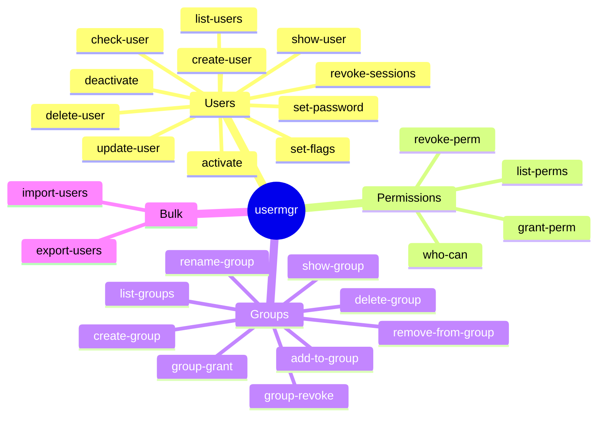
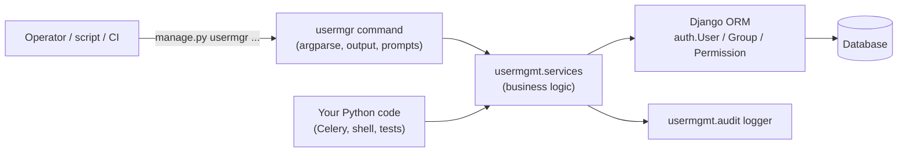

# django-usermgmt

<p align="center">
  
</p>

<p align="center">
  
</p>


A production-oriented command line toolkit for managing **users, groups and permissions** in any Django project.

Stock `manage.py` only ships `createsuperuser` and `changepassword`. There is no built-in way to create a regular
user, list users, inspect permissions, manage groups or import accounts in bulk. `django-usermgmt` adds a single
management command, `usermgr`, that covers all of that, with safety guards, audit logging and scriptable output.

```bash
python manage.py usermgr create-user john --email john@example.com --group editors --create-missing-groups
python manage.py usermgr list-users --active --format json
python manage.py usermgr who-can blog.add_post
```

## Highlights

- **26 actions** across users, permissions, groups and bulk import/export.
- **Custom user model support**: the login field is read from `USERNAME_FIELD`; extra fields via `--field KEY=VALUE`.
- **Safe password handling**: interactive prompt, stdin or environment variable; validated against
  `AUTH_PASSWORD_VALIDATORS`; never logged.
- **Safety guards**: the last active superuser cannot be deleted, deactivated or demoted without `--force`;
  destructive actions ask for confirmation.
- **Atomic and auditable**: every mutation runs in a transaction and writes a line to the `usermgmt.audit` logger.
- **Automation friendly**: `table`, `json` and `csv` output, stable exit codes, no prompts when stdin is not a TTY.
- **Layered design**: all logic lives in `usermgmt.services`; the command is a thin CLI wrapper you can bypass.

## Requirements

| Component | Version |
|---|---|
| Python | 3.9 or newer |
| Django | 4.2 or newer |

No third-party dependencies.

## Installation

1. Copy the `usermgmt/` directory into your project, next to `manage.py`.
2. Add it to `INSTALLED_APPS`:

   ```python
   INSTALLED_APPS = [
       # ...
       "django.contrib.auth",
       "django.contrib.contenttypes",
       "usermgmt",
   ]
   ```
3. Verify:

   ```bash
   python manage.py usermgr -h
   ```

See [`examples/settings_snippet.py`](examples/settings_snippet.py) for an audit-log configuration.

## Quick tour

```bash
# Create users
python manage.py usermgr create-user john --email john@example.com          # prompts for a password
echo "$PW" | python manage.py usermgr create-user sari --password-stdin
python manage.py usermgr create-user svc-sso --no-password                   # unusable password (SSO / API only)
python manage.py usermgr create-user ops --staff --group operators --create-missing-groups

# Inspect
python manage.py usermgr list-users --active --stale-days 90 --format csv
python manage.py usermgr show-user john --all-perms
python manage.py usermgr check-user john --perm auth.view_user

# Permissions and groups
python manage.py usermgr create-group editors --perm blog.add_post --perm blog.change_post
python manage.py usermgr add-to-group john editors
python manage.py usermgr grant-perm john "reports.*"
python manage.py usermgr who-can blog.add_post

# Lifecycle
python manage.py usermgr set-password john --revoke-sessions
python manage.py usermgr deactivate john --revoke-sessions

# Bulk
python manage.py usermgr import-users examples/users.csv --dry-run
python manage.py usermgr export-users --format csv --output users.csv
```

## Action overview



[](https://raw.githubusercontent.com/licface15/images/refs/heads/main/django-usermgmt/architecture1.jpg)

## How it fits together



[](https://raw.githubusercontent.com/licface15/images/refs/heads/main/django-usermgmt/architecture2.jpg)

## Documentation

| Document | Purpose |
|---|---|
| [User guide](docs/USER_GUIDE.md) | Task-oriented walkthroughs and recipes |
| [Command reference](docs/COMMAND_REFERENCE.md) | Every action, argument, output and exit code |
| [Architecture](docs/ARCHITECTURE.md) | Design, data model and flow diagrams |
| [Security guide](docs/SECURITY.md) | Threat model, password handling, audit logging, hardening checklist |
| [Developer guide](docs/DEVELOPER_GUIDE.md) | Using the service layer, extending the command, running tests |
| [Troubleshooting](docs/TROUBLESHOOTING.md) | Common errors and fixes |
| [Changelog](CHANGELOG.md) | Release history |

## Running the tests

```bash
python manage.py test usermgmt
```

## Known limitations

- Operates on the default database connection only (no `--database` option yet).
- `revoke-sessions` supports database-backed sessions (`django.contrib.sessions`) only.
- `who-can` evaluates permissions the way Django's `ModelBackend` does (superuser, direct, via group).
  Custom authentication backends with their own permission logic are not consulted.
- Passwords in import files are plain text; protect and delete those files (see the [security guide](docs/SECURITY.md)).


**for cli's color, install `pip install rchf`**

## 👤 Author
        
[Hadi Cahyadi](mailto:cumulus13@gmail.com)
    

[](https://www.buymeacoffee.com/cumulus13)

[](https://ko-fi.com/cumulus13)
 
[Support me on Patreon](https://www.patreon.com/cumulus13)
