# Architecture

This document explains how `django-usermgmt` is built and why. It is aimed at maintainers and at reviewers who
need to assess the module before deploying it.

## Contents

1. [Goals](#goals)
2. [Layers](#layers)
3. [Module map](#module-map)
4. [Error model](#error-model)
5. [Key flows](#key-flows)
6. [Last-superuser guard](#last-superuser-guard)
7. [Permission resolution and `who-can`](#permission-resolution-and-who-can)
8. [Transactions and consistency](#transactions-and-consistency)
9. [Custom user model support](#custom-user-model-support)
10. [Design decisions](#design-decisions)

---

## Goals

| Goal | How it is met |
|---|---|
| Robust | Validation before writes, atomic transactions, per-row isolation in bulk import |
| Safe | Last-superuser guard, confirmations, no secrets in argv by default or in logs |
| Reusable | All logic in a framework-level service layer with no I/O |
| Automatable | Stable exit codes, JSON/CSV output, no prompts without a TTY |
| Portable | Only public Django APIs, `USERNAME_FIELD`-aware, no third-party dependencies |

## Layers

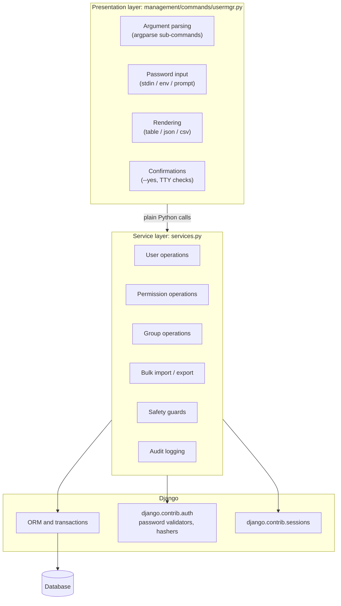

Rules of the layering:

- The presentation layer never touches the ORM directly (other than reading `USERNAME_FIELD` for one rename option).
- The service layer never prints, prompts or reads `sys.stdin`. It receives values and returns data or raises.
- Business rules (guards, validation, idempotency) live **only** in the service layer, so every caller gets them.

## Module map

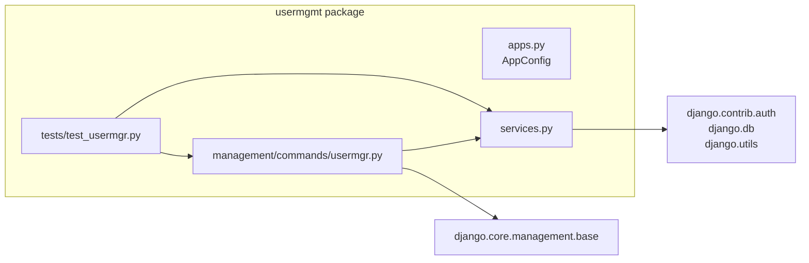

Inside `services.py`, functions are grouped by concern:

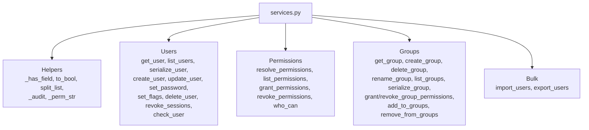

## Error model

All expected failures derive from `UserMgmtError`. The command converts them into `CommandError`
(exit code 1). Unexpected exceptions propagate with a traceback, except inside bulk import where each row is
isolated and reported.

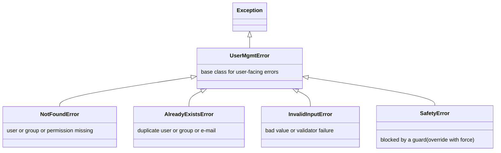

## Key flows

### `create-user`

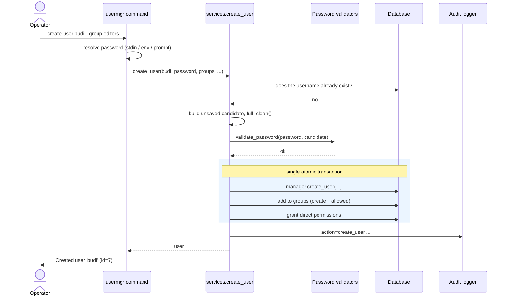

Validation happens **before** the transaction so that obvious mistakes never open one. The transaction still
protects against races: an `IntegrityError` from a concurrent creation is translated to `AlreadyExistsError`.

### `import-users`

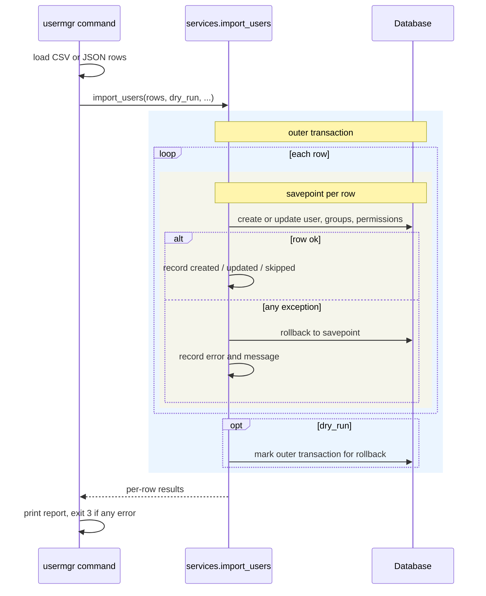

### Group membership change

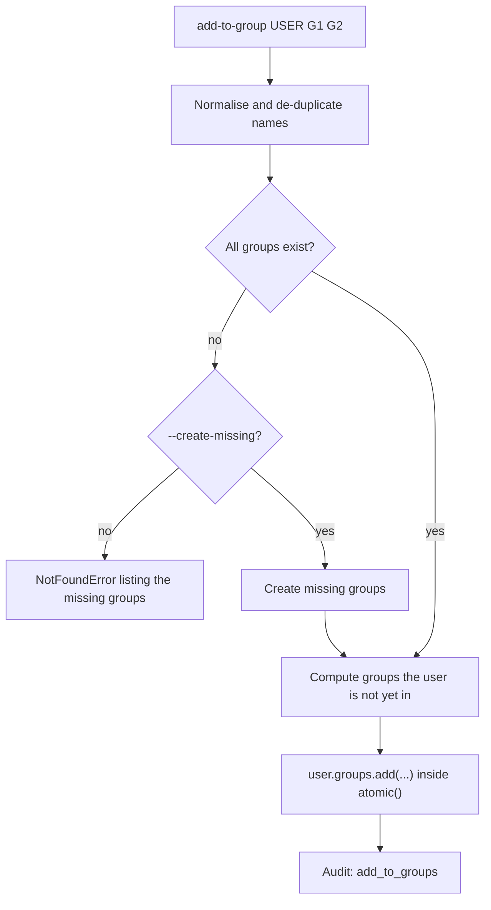

## Last-superuser guard

Locking yourself out of the system is the most damaging administrative mistake, so three operations are guarded:
`delete-user`, `deactivate` (or `set-flags --no-active`) and `set-flags --no-superuser`.

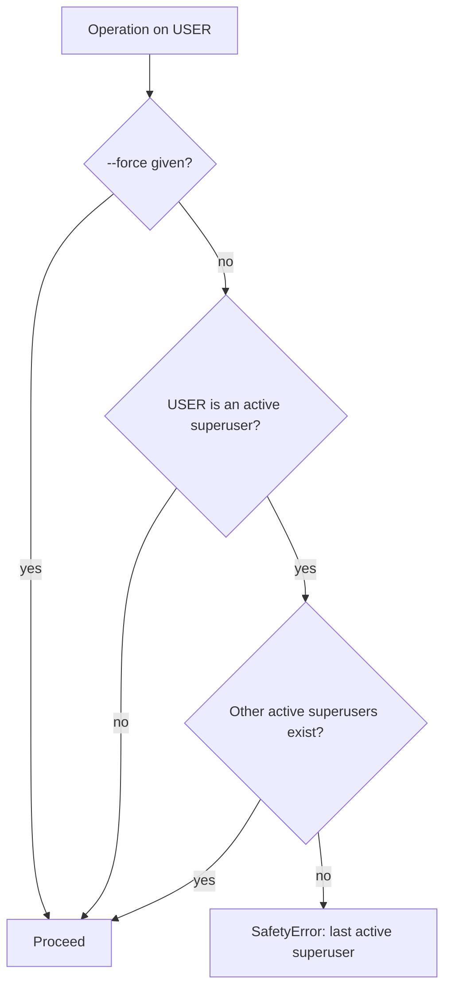

The check is a count query that excludes the target user. It is not serialised against concurrent administrators,
which is acceptable for an operator-driven CLI but worth knowing.

## Permission resolution and `who-can`

`resolve_permissions` turns user input into `Permission` rows:

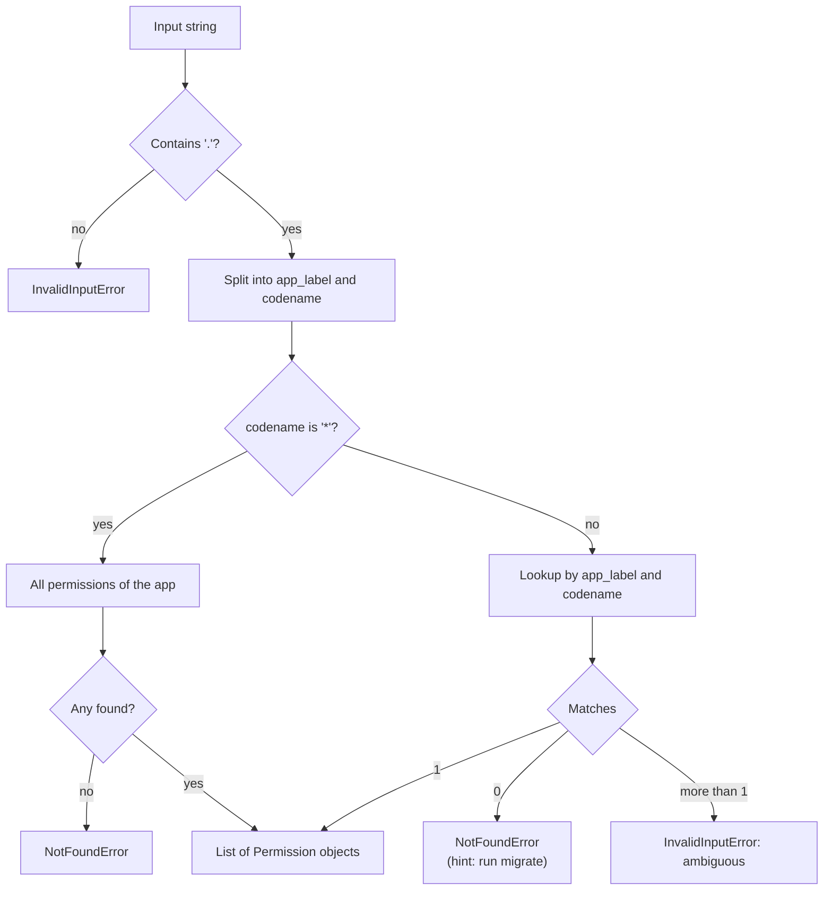

`who-can` reproduces the semantics of Django's `ModelBackend` in a single query for **active** users:

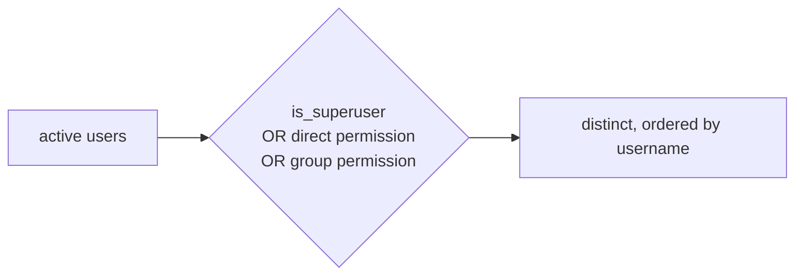

## Transactions and consistency

| Operation | Boundary |
|---|---|
| `create_user` | One `atomic()` around user creation, group membership and permission grants |
| `update_user`, `set_flags`, `set_password`, `delete_user` | One `atomic()` around the write |
| Permission and group changes | `atomic()` around the many-to-many update |
| `import_users` | Outer `atomic()` plus one savepoint per row; `dry_run` rolls back the outer block |
| `revoke_sessions` | Per-session delete; not transactional (sessions are disposable) |

Audit records are emitted after the transaction block returns, so a rolled-back change is not logged as done.
(Exception: in `import_users --dry-run`, inner operations log as they run; the final `import_users` record
carries `dry_run=True`.)

## Custom user model support

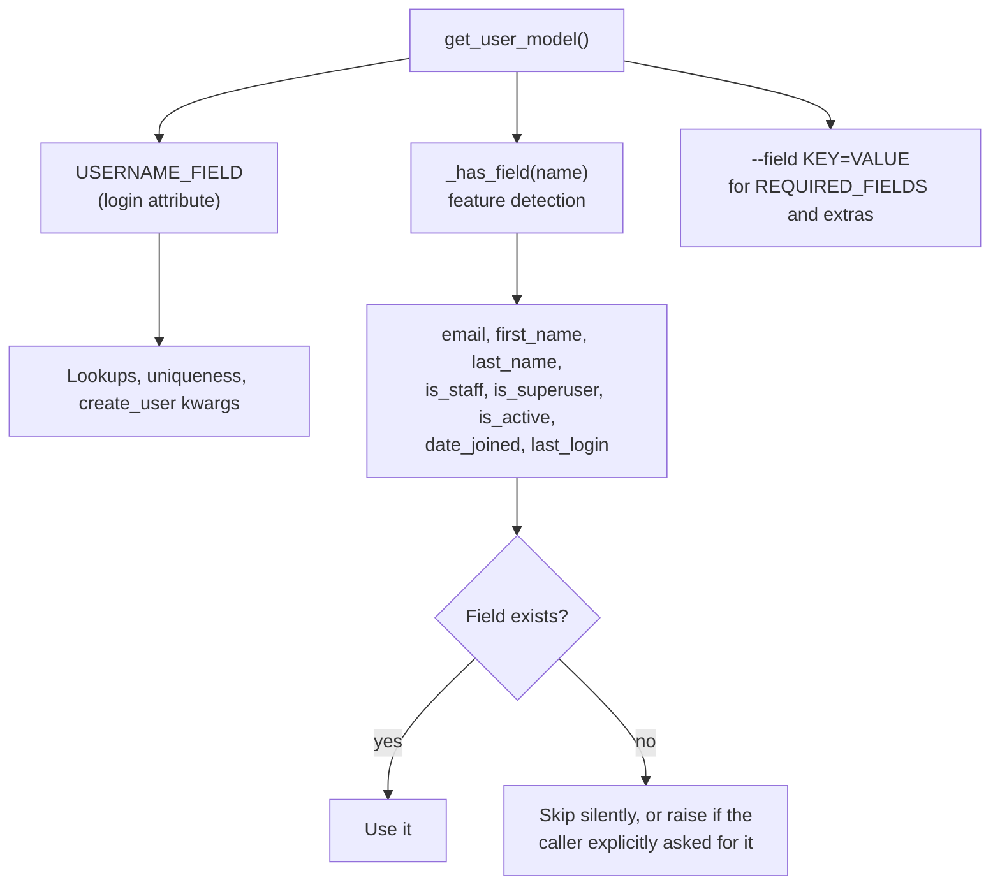

Requirements for a custom model: it must inherit `PermissionsMixin` (for groups and permissions) and its manager
must provide `create_user(<USERNAME_FIELD>=..., password=..., **extra)`.

## Design decisions

| Decision | Rationale |
|---|---|
| One command with sub-actions rather than many commands | One discoverable entry point (`usermgr -h`), shared options and helpers |
| Service layer separate from the CLI | Testable without parsing arguments; reusable from Celery, shell and views |
| Passwords never positional | Positional secrets leak through shell history and `ps` |
| Idempotent grants and group changes | Safe to re-run provisioning scripts |
| `full_clean()` on a candidate before creation | `create_user()` skips model validation; this catches bad e-mails and usernames early |
| Deactivate preferred over delete in docs | Preserves foreign keys and the audit trail |
| Audit via the `logging` module | Lets operators route records to files, syslog or SIEM without code changes |
| No `--database` option (yet) | Keeps every query on the default manager; see [limitations](../README.md#known-limitations) |

## 👤 Author
        
[Hadi Cahyadi](mailto:cumulus13@gmail.com)
    

 
[Support me on Patreon](https://www.patreon.com/cumulus13)