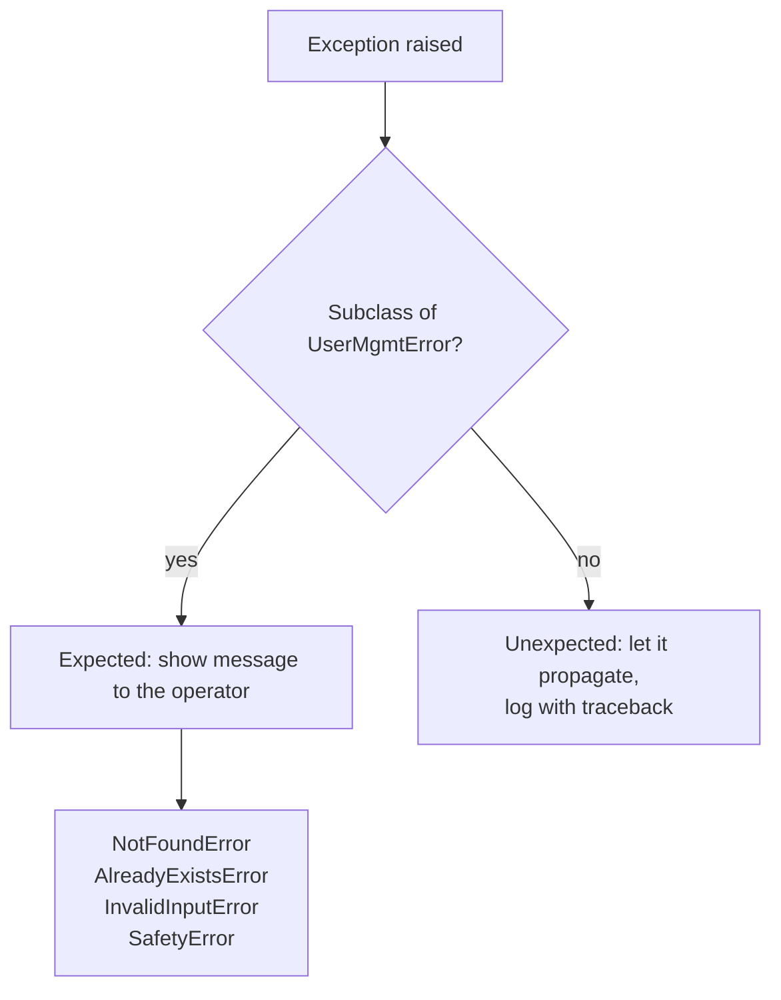
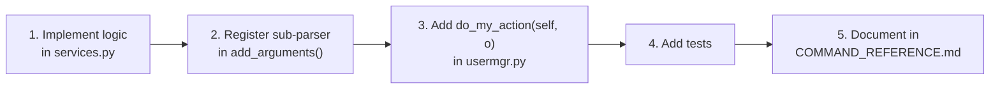

# Developer Guide

How to use the service layer from your own code, extend the command, and work on the test suite.

## Contents

1. [Using the service layer](#using-the-service-layer)
2. [Function reference](#function-reference)
3. [Adding a new action](#adding-a-new-action)
4. [Testing](#testing)
5. [Code conventions](#code-conventions)
6. [Release checklist](#release-checklist)

---

## Using the service layer

Everything the command does is available as plain Python functions in `usermgmt.services`. They never print or
prompt, so they are safe to call from Celery tasks, the Django shell, data migrations or views.

```python
from usermgmt import services as svc

try:
    user = svc.create_user(
        "budi",
        password="correct-horse-battery-staple-9",
        email="budi@example.com",
        groups=["editors"],
        create_missing_groups=True,
    )
    svc.grant_permissions(user, ["reports.view_report"])
except svc.AlreadyExistsError:
    user = svc.get_user("budi")
except svc.UserMgmtError as exc:      # NotFoundError, InvalidInputError, SafetyError, ...
    log.error("provisioning failed: %s", exc)
    raise
```

### Calling the command from code

```python
from io import StringIO
from django.core.management import call_command

out = StringIO()
call_command("usermgr", "list-users", "--format", "json", stdout=out)
```

Pass the action and its options as **strings**. Keyword arguments do not work well with argparse sub-commands.

### Handling errors



[](https://raw.githubusercontent.com/licface15/images/refs/heads/main/django-usermgmt/architecture14.jpg)

## Function reference

All functions raise subclasses of `UserMgmtError` for expected problems.

### Users

| Function | Returns | Notes |
|---|---|---|
| `get_user(identifier)` | user | Username, then e-mail, then numeric pk |
| `list_users(**filters)` | queryset | `search`, `is_active`, `is_staff`, `is_superuser`, `group`, `stale_days`, `never_logged_in`, `order_by`, `limit` |
| `serialize_user(user, detail=False, all_perms=False)` | dict | JSON-friendly |
| `create_user(identifier, *, password=None, email=None, first_name=None, last_name=None, is_staff=False, is_superuser=False, is_active=True, groups=(), permissions=(), create_missing_groups=False, extra_fields=None, validate_password=True, unique_email=False)` | user | `password=None` creates an unusable password |
| `update_user(user, **fields)` | user | Rejects password and `is_*` fields |
| `set_password(user, password, *, validate=True, revoke=False)` | int | Number of revoked sessions |
| `set_flags(user, *, is_active=None, is_staff=None, is_superuser=None, force=False)` | user | Guarded; superuser implies staff |
| `delete_user(user, *, force=False)` | str | Username that was deleted |
| `revoke_sessions(user)` | int | Database sessions only |
| `check_user(user, *, password=None, perms=())` | list of dict | Rows of `check`, `ok`, `detail` |
| `export_users(**filters)` | list of dict | Same filters as `list_users` |

### Permissions

| Function | Returns |
|---|---|
| `resolve_permissions(specs)` | list of `Permission` |
| `list_permissions(app_label=None, model=None, search=None)` | queryset |
| `grant_permissions(user, specs)` / `revoke_permissions(user, specs)` | `(changed, unchanged)` lists of `app.codename` |
| `who_can(spec)` | queryset of active users |

### Groups

| Function | Returns |
|---|---|
| `get_group(name)` | `Group` |
| `create_group(name, *, permissions=(), exist_ok=False)` | `(group, created)` |
| `delete_group(name, *, force=False)` | number of detached members |
| `rename_group(old, new)` | `Group` |
| `list_groups(search=None)` | queryset annotated with `user_count`, `permission_count` |
| `serialize_group(group)` | dict |
| `grant_group_permissions(name, specs)` / `revoke_group_permissions(name, specs)` | `(changed, unchanged)` |
| `add_to_groups(user, names, *, create_missing=False)` | list of newly joined group names |
| `remove_from_groups(user, names)` | list of group names actually left |

### Bulk

| Function | Returns |
|---|---|
| `import_users(rows, *, update_existing=False, validate_password=True, create_missing_groups=False, dry_run=False)` | list of `{row, username, status, message}` |

## Adding a new action

The command dispatches by name: action `my-action` is handled by method `do_my_action`.



[](https://raw.githubusercontent.com/licface15/images/refs/heads/main/django-usermgmt/architecture15.jpg)

Example: an action that lists users in a group by e-mail domain.

```python
# services.py
def users_by_domain(domain: str):
    if "." not in domain:
        raise InvalidInputError(f"'{domain}' does not look like a domain.")
    return _manager().filter(email__iendswith="@" + domain).order_by(user_model().USERNAME_FIELD)
```

```python
# management/commands/usermgr.py  (inside add_arguments)
p = add("list-by-domain", "List users whose e-mail ends with a domain.", fmt=True)
p.add_argument("domain")

# ... and as a method on Command
def do_list_by_domain(self, o):
    rows = [svc.serialize_user(u) for u in svc.users_by_domain(o["domain"])]
    self._render(rows, USER_COLUMNS, o["format"])
```

Guidelines for new actions:

- Put rules and validation in the service layer; keep the command method to argument plumbing and output.
- Mutations must be atomic and call `_audit(...)` with no secrets.
- Make state changes idempotent where possible.
- Raise `UserMgmtError` subclasses for expected failures so they become clean CLI errors.
- Destructive actions need `--yes` handling through `self._confirm`.

## Testing

```bash
python manage.py test usermgmt
python manage.py test usermgmt.tests.test_usermgr.ServiceTests.test_last_superuser_guard
```

The suite is split in two classes:

| Class | Scope |
|---|---|
| `ServiceTests` | Service layer: creation, duplicates, password validation, unusable passwords, superuser guard, groups and permissions, import isolation and dry-run |
| `CommandTests` | CLI: password-source enforcement, `--yes` enforcement, exit codes, create/list/show round trip |

Tips:

- Use a strong test password constant so validators pass; the tests use `Xk9#mPq2-vLz!7`.
- Patch `sys.stdin.isatty` to simulate non-interactive runs.
- Pass passwords to the command via `mock.patch.dict(os.environ, {...})` and `--password-env`.
- Tests assume the default `django.contrib.auth.User` model. If your project swaps the user model, adjust the
  `User` import and any fields such as `username`.

Suggested additional tests for your environment: your custom user model, your password validators, and a
`revoke-sessions` test with `SESSION_ENGINE = "django.contrib.sessions.backends.db"`.

## Code conventions

- Python 3.9+ syntax, type hints with `from __future__ import annotations`.
- All user-facing text, comments and docstrings are in English.
- No secrets in logs, exceptions or argv.
- Prefer feature detection (`_has_field`) over assuming the stock `User` model.
- Keep `services.py` free of `print`, `input`, `sys.stdin` and `sys.stdout`.

## Release checklist

1. Update `CHANGELOG.md`.
2. Run the test suite on every supported Django and Python version.
3. Re-read [`SECURITY.md`](SECURITY.md) for anything that changed.
4. Update [`COMMAND_REFERENCE.md`](COMMAND_REFERENCE.md) for new or changed options.
5. Tag the release.

## 👤 Author
        
[Hadi Cahyadi](mailto:cumulus13@gmail.com)
    

[](https://www.buymeacoffee.com/cumulus13)

[](https://ko-fi.com/cumulus13)
 
[Support me on Patreon](https://www.patreon.com/cumulus13)