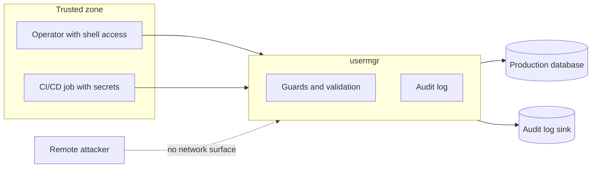
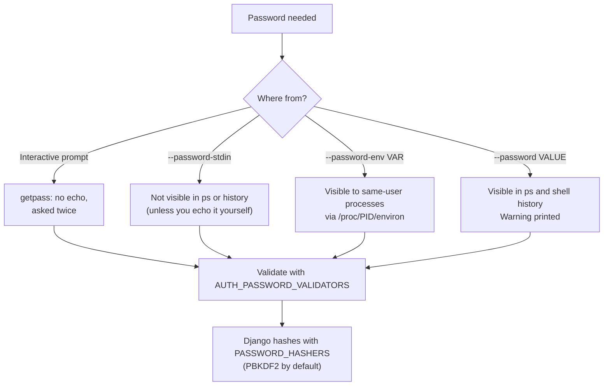
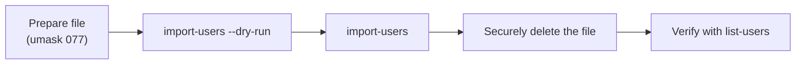

# Security Guide

`usermgr` manages credentials and privileges, so it deserves the same care as database access. This guide
describes what the tool protects against, what it leaves to you, and how to deploy it safely.

## Contents

1. [Trust model](#trust-model)
2. [Built-in protections](#built-in-protections)
3. [Password handling](#password-handling)
4. [Audit logging](#audit-logging)
5. [Handling import and export files](#handling-import-and-export-files)
6. [Production hardening checklist](#production-hardening-checklist)
7. [Reporting a vulnerability](#reporting-a-vulnerability)

---

## Trust model

`usermgr` is an **operator tool**, not a network service. Anyone who can run `manage.py` with your production
settings can already read and write the database directly. The tool therefore does not implement its own
authentication; it limits accidents and leaves a trail.



[](https://raw.githubusercontent.com/licface15/images/refs/heads/main/django-usermgmt/architecture16.jpg)

| In scope | Out of scope |
|---|---|
| Accidental lock-out, accidental deletion | A malicious operator with shell and database access |
| Weak passwords | Securing the host, the shell history or the CI secret store |
| Secrets leaking via arguments or logs | Network-level protection of the database |
| Untraceable privilege changes | Non-repudiation (the log records the OS user only) |

## Built-in protections

| Risk | Mitigation |
|---|---|
| Locking everyone out | Last active superuser cannot be deleted, deactivated or demoted without `--force` |
| Fat-finger deletes | `[y/N]` confirmation, `--yes` mandatory without a TTY, group deletion blocked while members exist |
| Weak credentials | `AUTH_PASSWORD_VALIDATORS` enforced on create, change and import |
| Secrets in process list | Passwords are never positional; `--password` prints a warning |
| Secrets in logs | The audit logger never receives passwords or hashes |
| Hanging pipelines | No prompt when stdin is not a TTY; the command fails fast instead |
| Partial writes | Atomic transactions; per-row savepoints in import |
| Hash disclosure | `export-users` omits password hashes; `show-user` only reports whether a usable password exists |
| Privilege escalation by typo | `grant-perm` rejects unknown permissions; wildcard grants require explicit `app.*` |
| Session persistence after compromise | `--revoke-sessions` on `set-password` and `deactivate` |

## Password handling



[](https://raw.githubusercontent.com/licface15/images/refs/heads/main/django-usermgmt/architecture17.jpg)

Recommendations:

- Prefer the interactive prompt for humans, and `--password-env` or `--password-stdin` for automation.
- Generate passwords instead of choosing them: `openssl rand -base64 24`.
- Unset or scope environment variables so they do not outlive the command.
- Never put `--password` in scripts committed to version control.
- Configure strong `AUTH_PASSWORD_VALIDATORS` and a modern `PASSWORD_HASHERS` order in your settings; this tool
  inherits whatever you configure.
- For service accounts that should never log in by password, use `--no-password`.

## Audit logging

Every mutation writes one record to the `usermgmt.audit` logger:

```
2026-11-16 10:42:07 action=grant_permissions actor=alice user='budi' perms=['blog.add_post']
```

Configure a dedicated handler (see [`examples/settings_snippet.py`](../examples/settings_snippet.py)) and:

- Write to a location only privileged users can modify; ship it to a remote log store or SIEM.
- Use `WatchedFileHandler` so `logrotate` works.
- Alert on sensitive actions: `set_flags` with `is_superuser=True`, `create_user` with `superuser=True`,
  `delete_user`, `grant_permissions` containing `.*`.
- Remember that `actor` is the **OS user** running the command. In CI this is the runner account, so correlate
  with your CI job logs for the human behind it.

Without a configured handler, Python's default logging configuration will drop `INFO` records. Configure one.

## Handling import and export files

Import files may contain plain-text passwords.



[](https://raw.githubusercontent.com/licface15/images/refs/heads/main/django-usermgmt/architecture18.jpg)

- Create the file with restrictive permissions (`umask 077`), keep it off shared folders and never commit it.
- Prefer leaving the `password` column empty and having users set passwords through your normal reset flow.
- Delete the file immediately after import (`shred -u users.csv` where available).
- Exported files contain usernames, e-mail addresses and group names. Treat them as personal data under your
  applicable privacy rules (for example GDPR).

## Production hardening checklist

- [ ] `usermgmt` is installed from a reviewed copy of this repository.
- [ ] `AUTH_PASSWORD_VALIDATORS` and `PASSWORD_HASHERS` are configured deliberately.
- [ ] A dedicated `usermgmt.audit` handler exists and its output is retained and monitored.
- [ ] Shell access to production is limited and logged (SSH session recording, `sudo` logging).
- [ ] Automation uses `--password-env` or `--password-stdin`, never `--password`.
- [ ] CI secrets are masked in job logs.
- [ ] At least two active superusers exist, so the last-superuser guard is never what blocks you.
- [ ] `--force` and `--skip-password-validation` are not used in routine scripts.
- [ ] Import files are generated with restrictive permissions and deleted after use.
- [ ] Tests (`python manage.py test usermgmt`) pass in your environment before each upgrade.

## Known security-relevant limitations

- The last-superuser guard is a point-in-time check, not a lock; two administrators acting at the same moment
  could both pass it.
- `who-can` models Django's default `ModelBackend` only. Custom backends may grant or deny differently.
- `revoke-sessions` works for database sessions only; cache, signed-cookie and file sessions are not affected.
- `--field KEY=VALUE` values are passed as strings and rely on the model field to coerce and validate them.

## Reporting a vulnerability

If you embed this module in a project, publish a contact address for security reports in that project's
`SECURITY.md` and route reports there. Do not disclose vulnerabilities in public issue trackers.

## 👤 Author
        
[Hadi Cahyadi](mailto:cumulus13@gmail.com)
    

[](https://www.buymeacoffee.com/cumulus13)

[](https://ko-fi.com/cumulus13)
 
[Support me on Patreon](https://www.patreon.com/cumulus13)