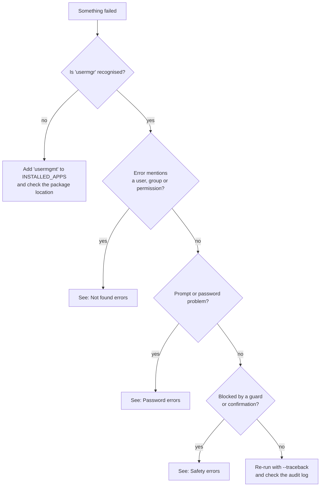

# Troubleshooting

## Diagnostic flow



[](https://raw.githubusercontent.com/licface15/images/refs/heads/main/django-usermgmt/architecture19.jpg)

Use `--traceback` (a standard Django option, placed before the action) to see the full stack trace:

```bash
python manage.py usermgr --traceback create-user budi --no-password
```

## Command not found

| Symptom | Cause and fix |
|---|---|
| `Unknown command: 'usermgr'` | `usermgmt` is missing from `INSTALLED_APPS`, or the directory is not importable from the project root. |
| `ModuleNotFoundError: usermgmt` | Run from the directory containing `manage.py`, or fix `PYTHONPATH`. |
| Works locally, not in production | Production uses different settings or a different copy of the code. Check `--settings`. |

## Not found errors

| Message | Cause and fix |
|---|---|
| `User 'x' not found.` | Check spelling. Lookup order is username, e-mail, then numeric id. |
| `E-mail 'x' matches several users` | E-mail addresses are not unique in your database. Use the username. |
| `Permission 'app.codename' not found (did you run migrate?)` | Permissions are created by `migrate`. Run it, or list valid names with `usermgr list-perms --app app`. |
| `No permissions for app 'x'` | The app label is wrong. It is the label, not the Python path (`blog`, not `myproject.blog`). |
| `Group(s) not found: ...` | Create them first, or add `--create-missing` / `--create-missing-groups`. |

## Password errors

| Message | Cause and fix |
|---|---|
| `No password source: use --password-stdin, --password-env VAR, or --no-password.` | Stdin is not a terminal. Provide a source, or use `--no-password` for `create-user`. |
| `Environment variable X is not set.` | Export it in the same shell or job step that runs the command. |
| `Passwords do not match.` | The two prompts differed. Run again. |
| `Password must not be empty.` | Empty stdin line or empty variable. |
| Validator messages (too short, too common, ...) | Your `AUTH_PASSWORD_VALIDATORS` rejected it. Pick a stronger password; use `--skip-password-validation` only deliberately. |
| `--password-stdin` reads nothing | You must pipe input: `echo "$PW" \| python manage.py usermgr ...`. |

## Safety errors

| Message | Cause and fix |
|---|---|
| `Refusing to delete/deactivate/demote 'x': it is the last active superuser.` | Create another superuser first (`create-user other --superuser`), or pass `--force` if you are certain. |
| `Group 'x' still has N member(s).` | Remove members (`remove-from-group`) or use `delete-group --force`. |
| `Confirmation required: re-run with --yes in non-interactive mode.` | Add `--yes` to `delete-user` or `delete-group` in scripts. |
| `Aborted.` | You answered anything other than `y` to the confirmation. |

## Validation and creation errors

| Message | Cause and fix |
|---|---|
| `User 'x' already exists.` | Choose another name, or use `update-user`. |
| `E-mail 'x' is already used.` | Raised only with `--unique-email`. |
| `User model has no field 'x'.` | Typo in `--field`, or the field does not exist on your custom model. |
| Messages from `full_clean()` (invalid e-mail, username characters, missing required field) | Fix the value. For custom models, supply `REQUIRED_FIELDS` with `--field KEY=VALUE`. |
| `Invalid --field 'x', expected KEY=VALUE.` | Missing `=`. |
| `Field 'is_staff' cannot be changed here` | Use `set-flags`, not `update-user`. |

## Import problems

| Symptom | Cause and fix |
|---|---|
| `Unsupported file type (use .csv or .json).` | Rename the file or convert it. |
| `Cannot parse file: ...` | Invalid JSON, wrong encoding (use UTF-8) or malformed CSV. |
| `JSON must be a list of objects (or {'users': [...]})` | Check the top-level structure. |
| Rows show `skipped` | The user exists. Add `--update` to modify existing users. |
| Rows show `error` | Read the message column. Typical causes: weak password, unknown group, bad boolean. |
| `Cannot interpret 'x' as a boolean.` | Use `true/false`, `yes/no`, `1/0` or `on/off`. |
| Exit code 3 after a successful-looking run | At least one row failed; the summary line on stderr shows the counts. |
| Dry run says `created` but nothing appears | Expected: `--dry-run` rolls everything back. |

## Sessions

| Symptom | Cause and fix |
|---|---|
| `django.contrib.sessions is not installed.` | Add it to `INSTALLED_APPS` or skip `--revoke-sessions`. |
| `0 session(s) revoked.` but the user is still logged in | You use cache, file or signed-cookie sessions. Only database sessions can be revoked here; for signed cookies, rotate the user's password hash or `SECRET_KEY` policy as appropriate. |

## Output and automation

| Symptom | Cause and fix |
|---|---|
| Table output is garbled in logs | Use `--format json` or `--format csv`, or add `--no-color`. |
| Pipeline hangs | Something is waiting for input in an environment that looks interactive. Always supply a password source and `--yes`. |
| JSON output is mixed with warnings | Warnings go to stderr; redirect only stdout (`> out.json`). |
| Non-zero exit code from `check-user` | Exit code `3` means a check failed; read the table. |

## Still stuck?

1. Re-run with `--traceback`.
2. Look at the `usermgmt.audit` log to see which steps completed.
3. Run `python manage.py test usermgmt` to confirm the module works in your environment.
4. Reproduce with `show-user`, `list-perms` and `list-groups` to confirm the state of the data.

## 👤 Author
        
[Hadi Cahyadi](mailto:cumulus13@gmail.com)
    

[](https://www.buymeacoffee.com/cumulus13)

[](https://ko-fi.com/cumulus13)
 
[Support me on Patreon](https://www.patreon.com/cumulus13)