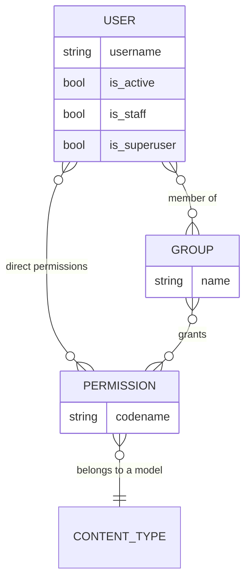
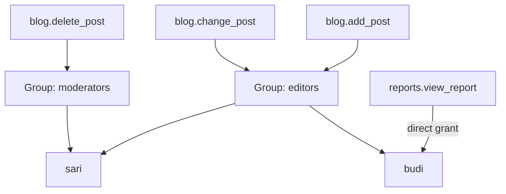
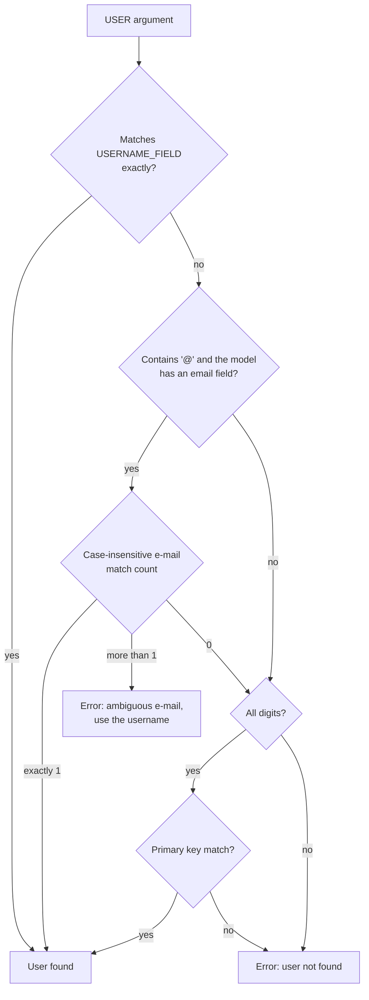
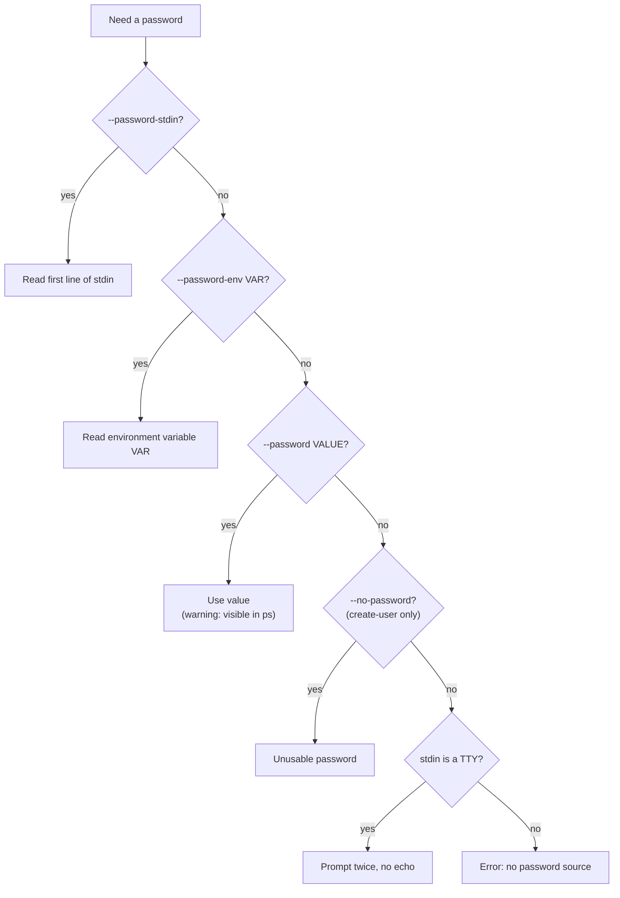
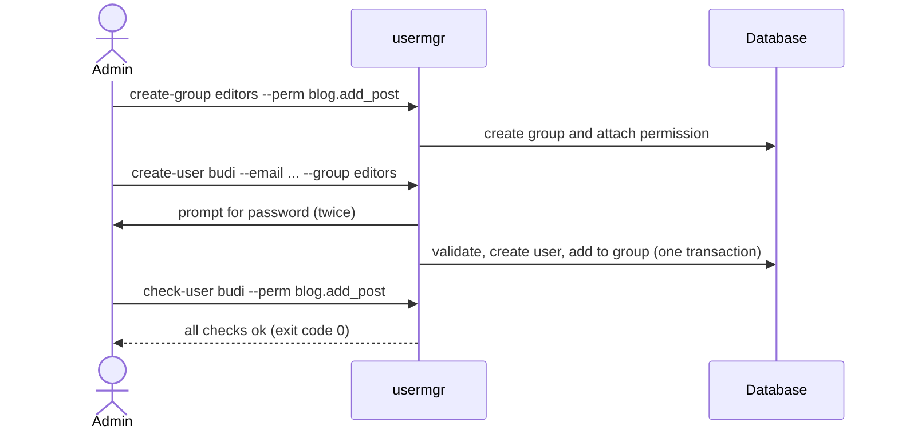
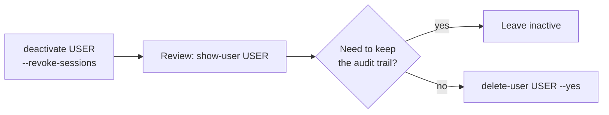
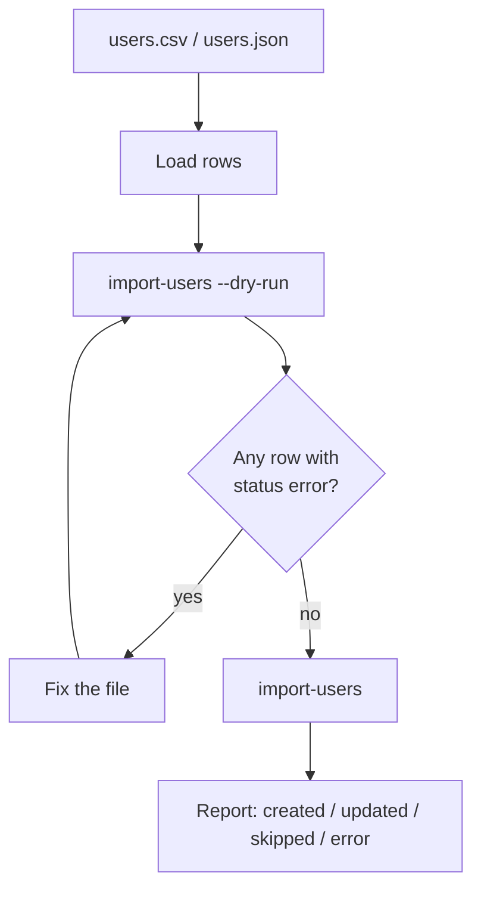

# User Guide

A task-oriented guide to `python manage.py usermgr`. For the exhaustive list of arguments see the
[command reference](COMMAND_REFERENCE.md).

## Contents

1. [Core concepts](#1-core-concepts)
2. [Identifying a user](#2-identifying-a-user)
3. [Supplying passwords](#3-supplying-passwords)
4. [Output formats](#4-output-formats)
5. [Recipes](#5-recipes)
6. [Safety behaviour you should know about](#6-safety-behaviour-you-should-know-about)
7. [Scripting and automation](#7-scripting-and-automation)

---

## 1. Core concepts

Django authorization has three building blocks. `usermgr` manages all of them.



[](https://raw.githubusercontent.com/licface15/images/refs/heads/main/django-usermgmt/architecture20.jpg)

| Concept | Meaning |
|---|---|
| **User** | An account. `is_active` allows login, `is_staff` allows access to the Django admin, `is_superuser` implies every permission. |
| **Group** | A named set of permissions. Add users to a group instead of granting permissions one by one. |
| **Permission** | Written as `app_label.codename`, for example `blog.add_post`. `app_label.*` selects every permission of an app. |

A user's **effective permissions** are the union of: all permissions (if superuser), direct permissions, and
permissions inherited through groups. Inactive users have no effective permissions.

### Typical access model



[](https://raw.githubusercontent.com/licface15/images/refs/heads/main/django-usermgmt/architecture21.jpg)

---

## 2. Identifying a user

Every action that takes a `USER` argument resolves it in this order:



[](https://raw.githubusercontent.com/licface15/images/refs/heads/main/django-usermgmt/architecture22.jpg)

So `budi`, `budi@example.com` and `42` can all refer to the same account.

---

## 3. Supplying passwords

Actions that need a password (`create-user`, `set-password`, optionally `check-user`) accept these sources.
The first one that is present wins.



[](https://raw.githubusercontent.com/licface15/images/refs/heads/main/django-usermgmt/architecture23.jpg)

Recommended order of preference for automation: `--password-env`, then `--password-stdin`.
Avoid `--password` outside of throwaway development databases.

Passwords are validated against your `AUTH_PASSWORD_VALIDATORS`. Use `--skip-password-validation`
only for deliberate exceptions such as seeding a test environment.

---

## 4. Output formats

Listing and inspection actions accept `--format table|json|csv`.

```bash
python manage.py usermgr list-users                    # human-readable table (default)
python manage.py usermgr list-users --format json | jq '.[].username'
python manage.py usermgr list-users --format csv > users.csv
```

In `csv` output, list values (such as groups) are joined with `;`.

---

## 5. Recipes

### 5.1 Onboard a new employee



[](https://raw.githubusercontent.com/licface15/images/refs/heads/main/django-usermgmt/architecture24.jpg)

```bash
python manage.py usermgr create-group editors --perm blog.add_post --perm blog.change_post
python manage.py usermgr create-user budi --email budi@example.com --first-name Budi --group editors
python manage.py usermgr check-user budi --perm blog.add_post
```

### 5.2 Create a staff user for the Django admin

```bash
python manage.py usermgr create-user ops --staff --group operators --create-missing-groups
```

`--staff` allows admin login, but the user still needs permissions (through groups or direct grants) to see or edit
anything in the admin.

### 5.3 Create a service account with no password

```bash
python manage.py usermgr create-user svc-reports --no-password --perm reports.view_report
```

The account has an unusable password: it cannot log in with a password, but can still be used with tokens or SSO
that you wire up separately.

### 5.4 Role-based access with groups

```bash
python manage.py usermgr create-group moderators
python manage.py usermgr group-grant moderators blog.delete_post blog.change_post
python manage.py usermgr add-to-group sari moderators editors
python manage.py usermgr show-group moderators
python manage.py usermgr remove-from-group sari editors
```

`group-grant` and `grant-perm` are idempotent: permissions that are already present are reported as
"No change" rather than failing.

### 5.5 Grant every permission of an app

```bash
python manage.py usermgr grant-perm budi "billing.*"
```

Quote the argument so your shell does not expand `*`.

### 5.6 Find out who can do something

```bash
python manage.py usermgr who-can blog.add_post
```

Lists active users that hold the permission directly, through a group, or as superusers.

### 5.7 Discover permission names

```bash
python manage.py usermgr list-perms --app blog
python manage.py usermgr list-perms --search delete --format json
```

### 5.8 Rotate a password and sign the user out everywhere

```bash
python manage.py usermgr set-password budi --revoke-sessions
```

`--revoke-sessions` deletes every active database session that belongs to the user. It requires
`django.contrib.sessions` with the database session backend.

### 5.9 Offboard a leaver



[](https://raw.githubusercontent.com/licface15/images/refs/heads/main/django-usermgmt/architecture25.jpg)

```bash
python manage.py usermgr deactivate budi --revoke-sessions
python manage.py usermgr show-user budi
# Only if you really want to remove the row (and related data that cascades):
python manage.py usermgr delete-user budi --yes
```

Deactivation is reversible (`activate`) and keeps foreign-key references intact, so it is usually the better choice.

### 5.10 Clean up stale accounts

```bash
# Active accounts with no login in the last 180 days (or never logged in and older than 180 days)
python manage.py usermgr list-users --active --stale-days 180

# Accounts that never logged in at all
python manage.py usermgr list-users --never-logged-in --order-by -date_joined
```

### 5.11 Promote or demote privileges

```bash
python manage.py usermgr set-flags budi --staff
python manage.py usermgr set-flags budi --superuser     # also sets is_staff unless --no-staff is given
python manage.py usermgr set-flags budi --no-superuser --no-staff
```

### 5.12 Update profile data and rename

```bash
python manage.py usermgr update-user budi --email new@example.com --first-name Budi
python manage.py usermgr update-user budi --new-username budi.santoso
python manage.py usermgr update-user budi --field department=finance      # custom model field
```

Changes are validated with the model's `full_clean()` (field validators and uniqueness) before saving.
Flags and passwords cannot be changed here; use `set-flags` and `set-password`.

### 5.13 Bulk import



[](https://raw.githubusercontent.com/licface15/images/refs/heads/main/django-usermgmt/architecture26.jpg)

Supported columns (all optional except the username):

| Column | Notes |
|---|---|
| `username` | Or the column named by your model's `USERNAME_FIELD` |
| `email`, `first_name`, `last_name` | Profile fields |
| `password` | Blank means unusable password for new users; ignored for existing users unless `--update` |
| `is_staff`, `is_superuser`, `is_active` | `true/false`, `yes/no`, `1/0`, `on/off` |
| `groups`, `permissions` | Lists separated by `;`, `,` or `\|`; JSON also accepts real arrays |

```bash
python manage.py usermgr import-users examples/users.csv --dry-run
python manage.py usermgr import-users examples/users.csv --create-missing-groups
python manage.py usermgr import-users examples/users.csv --update      # also update existing users
```

Rules:

- Each row runs in its own savepoint. A bad row is reported and skipped; the rest still import.
- `--dry-run` validates everything and rolls the whole import back.
- Existing users are `skipped` unless `--update` is given. Updates are additive: groups and permissions are
  added, never removed.
- The process exits with code `3` if any row failed.

### 5.14 Export and back up account definitions

```bash
python manage.py usermgr export-users --format csv --output users.csv
python manage.py usermgr export-users --group editors --active
```

Exports never contain password hashes. The CSV is compatible with `import-users`, which makes it convenient for
copying account definitions between environments (users will get unusable passwords unless you add a
`password` column).

### 5.15 Sign in with e-mail (custom user model)

If your `AUTH_USER_MODEL` uses `USERNAME_FIELD = "email"`, the first positional argument is the e-mail address,
and any `REQUIRED_FIELDS` can be passed with `--field`:

```bash
python manage.py usermgr create-user budi@example.com --field full_name="Budi Santoso" --group editors
```

---

## 6. Safety behaviour you should know about

| Situation | Behaviour |
|---|---|
| Deleting, deactivating or demoting the last active superuser | Refused with an error. Override with `--force`. |
| `delete-user`, `delete-group` | Ask `[y/N]`. When stdin is not a terminal, `--yes` is required. |
| Deleting a group that still has members | Refused. Override with `--force`. |
| Weak password | Refused with the validator messages. Override with `--skip-password-validation`. |
| Creating a user that already exists | Refused. `--unique-email` additionally rejects reused e-mail addresses. |
| Unknown group in `create-user --group` or `add-to-group` | Refused. Add `--create-missing-groups` / `--create-missing`. |
| Every mutation | Atomic, and logged to `usermgmt.audit`. |

---

## 7. Scripting and automation

Exit codes:

| Code | Meaning |
|---|---|
| `0` | Success |
| `1` | Error (not found, already exists, invalid input, safety guard, aborted) |
| `2` | Invalid command line usage (argparse) |
| `3` | `check-user` had a failing check, or `import-users` had row errors |

Example CI step that provisions a user and verifies the result:

```bash
set -euo pipefail
export NEW_USER_PW="$(openssl rand -base64 24)"

python manage.py usermgr create-user deploy-bot \
    --password-env NEW_USER_PW \
    --group ci --create-missing-groups

python manage.py usermgr check-user deploy-bot --perm app.deploy --format json
```

Tips:

- When stdin is not a TTY, nothing ever prompts. Missing passwords or missing `--yes` become immediate errors,
  so pipelines fail fast instead of hanging.
- Use `--format json` for machine parsing and `--format csv` for spreadsheets.
- Messages and tables go to stdout; warnings and the import summary go to stderr.

## 👤 Author
        
[Hadi Cahyadi](mailto:cumulus13@gmail.com)
    

[](https://www.buymeacoffee.com/cumulus13)

[](https://ko-fi.com/cumulus13)
 
[Support me on Patreon](https://www.patreon.com/cumulus13)